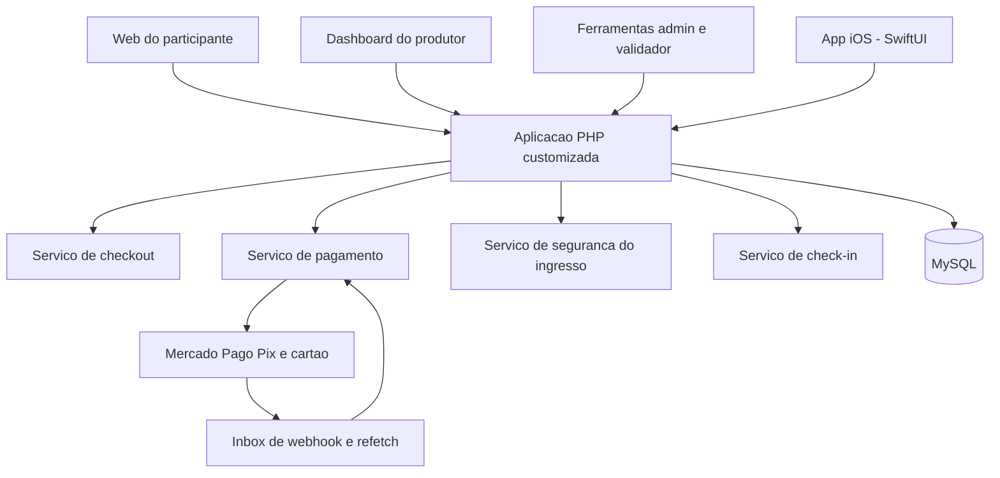

# TickiTon

### Bilheteria / Eventos / Pagamentos / Sistemas Transacionais

No ar em [tickiton.com.br](https://tickiton.com.br) · App iOS na [App Store](https://apps.apple.com/br/app/tickiton/id6824281845)

## Visão Geral

TickiTon é uma plataforma de bilheteria para eventos, com web e app iOS nativo. O código é privado; este repositório documenta o produto como estudo de caso.

O produto cobre descoberta de eventos, seleção de ingressos, checkout, confirmação de pagamento, geração de ingressos, validação por QR Code, operação de produtores, fluxos administrativos e reembolsos.

Este repositório não contém código proprietário, credenciais, dados de clientes, dumps de banco ou detalhes internos de infraestrutura.

## Problema

Uma bilheteria é um sistema transacional. Ela precisa vender ingressos sem estourar estoque, confirmar pagamento antes de liberar acesso, emitir ingressos únicos, validar entrada no evento e manter produtor/admin alinhados enquanto pagamentos e webhooks chegam de forma assíncrona.

## Solução

O código privado implementa um backend customizado em PHP 8.2 com rotas web e API, persistência MySQL, integração Mercado Pago Pix/cartão, QR Codes assinados para ingressos, serviços de check-in, dashboards de produtor, superfícies administrativas e testes de confiabilidade.

Reserva de estoque, cálculo de cupom, transições de pagamento e emissão de ingresso são tratados no servidor, evitando que o frontend determine resultados transacionais.

## Fluxo do Produto

## Arquitetura do Sistema

## Stack Técnica

- Backend: PHP 8.2, estrutura customizada PSR-4 e PHPUnit.
- Web/API: rotas públicas, participante, produtor, validador e admin.
- Banco de dados: MySQL.
- Pagamentos: checkout Mercado Pago Pix e cartão.
- QR: tokens de ingresso assinados com HMAC.
- Documentos: geração de PDFs para artefatos relacionados a ingressos.
- Mobile: app iOS nativo em SwiftUI, publicado na App Store e ligado à mesma API da web.

## Engenharia Backend

O backend inclui rotas e serviços para autenticação, navegação de eventos, checkout, pedidos do participante, visualização de ingressos, gestão de eventos pelo produtor, relatórios de venda, carteira, saques, validadores, check-in e operações administrativas.

O checkout valida status do evento, limites de ingresso, disponibilidade de lote, dados dos participantes, regras de cupom e restrições de método de pagamento antes de permitir avanço do pedido.

A emissão de ingresso é ligada à finalização do pagamento. O sistema não libera ingresso válido apenas porque uma tentativa de checkout foi criada.

## Dados / Banco de Dados

O modelo privado inclui eventos, tipos de ingresso, pedidos, itens de pedido, ingressos, usuários, produtores, validadores, check-ins, eventos de webhook, reembolsos, disputas, carteira, suporte e dados de auditoria operacional.

Campos de reserva de estoque e índices de expiração de pedido dão suporte a fluxos onde demanda e confirmação de pagamento não são instantâneas.

## Integrações

- Criação de pagamentos Mercado Pago Pix e cartão.
- Webhooks Mercado Pago e refetch de pagamento.
- Entrega de e-mails transacionais.
- Suporte a autenticação Google.
- Bibliotecas de QR Code e PDF.

## Segurança

Detalhes confirmados no código privado:

- Fluxos separados por papéis: participante, produtor, validador e admin.
- QR Code de ingresso assinado com HMAC-SHA256.
- Exigência de segredo forte de assinatura em produção.
- Validação de status de pagamento antes do check-in.
- Validação de assinatura de webhook.
- Validação server-side de estoque, cupom e parcelamento.
- Nenhuma exposição pública de código-fonte privado ou histórico Git do projeto comercial.

## Desafios de Engenharia

- Evitar overselling durante tentativas concorrentes de checkout.
- Liberar reservas expiradas com segurança.
- Evitar emissão duplicada de ingressos quando webhooks são reenviados.
- Validar QR Code sem expor identificadores previsíveis.
- Bloquear check-in duplicado.
- Executar reembolso apenas após confirmação do gateway.
- Manter participante, produtor, validador e admin consistentes em torno dos mesmos registros de pedido e ingresso.

## Testes e Confiabilidade

O projeto privado contém testes unitários, de feature e de carga para pagamentos, reserva de estoque, limites de ingresso, cupons, login Google, propriedade dos participantes, segurança do QR, e-mails transacionais, reembolsos, readiness checks e headers de segurança.

Também existem materiais de teste de carga e invariantes SQL para cenários de evento com alto volume, incluindo validações contra estoque negativo, QR/acessos duplicados e check-ins repetidos.

Resultado de referência: 500 compradores disputando 300 vagas no mesmo lote terminaram com 300 ingressos vendidos e nenhum a mais.

## Infraestrutura e Deploy

O repositório privado inclui material de deploy para hospedagem de produção, referências Docker/Cloud Run, documentação para cPanel e recomendações de Cloudflare. Domínios, contas e caminhos operacionais não são publicados.

## Produção

O código contém documentação de readiness e operação, incluindo hardening de assets públicos e validação de carga para eventos. Este estudo de caso não publica endpoints sensíveis nem detalhes internos da infraestrutura.

## Capturas de Tela

Capturas de tela não foram incluídas porque as imagens existentes podem conter dados de checkout, participantes ou eventos.

## Meu Papel / O Que Construí

Este case demonstra engenharia backend e full stack para bilheteria de eventos: checkout, reserva de estoque, integração de pagamento, segurança de QR Code, check-in, ferramentas de produtor/admin, app iOS, modelagem de dados, testes e operação em produção.

## Decisões Técnicas Principais

- Tratar bilheteria como fluxo transacional, não como formulário de compra no frontend.
- Reservar estoque de forma atômica antes da confirmação final.
- Emitir ingressos somente após confirmação de pagamento.
- Assinar payloads de QR em vez de expor identificadores sequenciais.
- Manter a documentação pública separada do repositório comercial privado.
