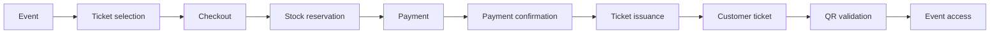
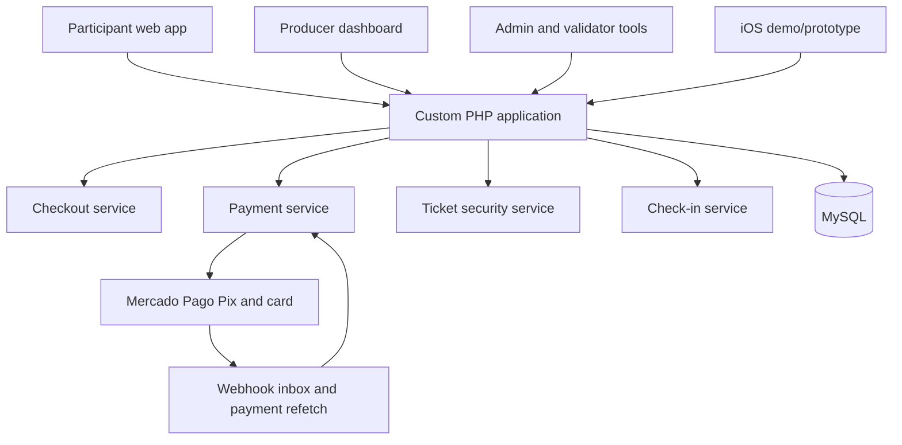

# TickiTon

### Ticketing / Events / Payments / Transactional Systems

## Overview

TickiTon is a private event ticketing platform documented here as a safe public engineering case study.

The product covers event discovery, ticket selection, checkout, payment confirmation, ticket generation, QR-based validation, producer operations, administrative workflows and refund handling.

This repository does not contain proprietary source code, credentials, production URLs, customer data, database dumps or internal infrastructure details.

## Problem

An event ticketing system is a transactional product. It must sell tickets without overselling stock, confirm payment before granting access, issue unique tickets, validate entry at the venue and keep producer/admin operations consistent while payments and webhooks may arrive asynchronously.

## Solution

The private codebase implements a custom PHP 8.2 backend with web and API routes, MySQL persistence, Mercado Pago Pix/card integration, signed QR ticket tokens, check-in services, producer dashboards, admin surfaces and reliability tests.

Stock reservation, coupon calculation, payment state transitions and ticket issuance are handled server-side so the frontend cannot decide transactional outcomes.

## Product Flow

## System Architecture

## Tech Stack

- Backend: PHP 8.2, custom PSR-4 application structure, PHPUnit.
- Web/API: Public, participant, producer, validator and admin routes.
- Database: MySQL.
- Payments: Mercado Pago Pix and card checkout.
- QR: Signed ticket tokens with HMAC validation.
- Documents: PDF generation for ticket-related artifacts.
- Mobile: Native SwiftUI iOS demo/prototype prepared for API integration; not presented as the primary production surface.

## Backend Engineering

The backend includes routes and services for authentication, event browsing, checkout, participant orders, ticket display, producer event management, sales reporting, wallet operations, withdrawals, validators, check-in and admin operations.

Checkout validates event status, ticket limits, lot availability, holder data, coupon rules and payment method constraints before an order can proceed.

Ticket issuance is tied to payment finalization. The system does not grant valid ticket access simply because a checkout request was created.

## Data / Database

The private database model includes events, ticket types, orders, order items, tickets, users, producers, validators, check-ins, webhook events, refunds, disputes, wallet-related tables and operational audit data.

Stock reservation fields and order expiration indexes support checkout flows where demand and payment confirmation are not instantaneous.

## Integrations

- Mercado Pago Pix and card payment creation.
- Mercado Pago webhook handling and payment refetch.
- Email delivery for transactional communication.
- Google authentication support.
- PDF and QR generation libraries.

## Security

Security-relevant implementation details confirmed in the private codebase:

- Role-separated participant, producer, validator and admin workflows.
- Signed QR ticket tokens using HMAC-SHA256.
- Production requirement for strong ticket signing secrets.
- Payment status validation before check-in.
- Webhook signature validation.
- Server-side stock, coupon and installment validation.
- No public exposure of private source code or project Git history.

## Engineering Challenges

- Preventing oversold ticket inventory during concurrent checkout attempts.
- Releasing expired reservations safely.
- Avoiding duplicate ticket issuance when webhooks are retried.
- Validating QR tickets without leaking predictable identifiers.
- Blocking duplicate check-ins.
- Handling refunds only after gateway confirmation.
- Keeping participant, producer, validator and admin workflows consistent around the same order and ticket records.

## Testing & Reliability

The private project contains unit, feature and load-oriented tests around payment flows, stock reservation, ticket limits, coupon redemption, Google login, ticket holder ownership, QR security, transactional emails, refunds, readiness checks and security headers.

Load testing material and SQL invariant checks exist for high-volume event scenarios, including checks for no oversold stock, no duplicate QR/access codes and no double check-ins.

## Infrastructure & Deployment

The private repository includes deployment material for production-style hosting, including Docker/Cloud Run references, cPanel-oriented deployment documentation and Cloudflare recommendations. Exact domains, accounts and operational paths are intentionally not published.

## Production

The codebase contains production-readiness and operational documentation, including hardening work related to public asset rendering and event-load validation. This public case study avoids publishing sensitive endpoints or internal infrastructure details.

## Screenshots

Screenshots are not included in this repository because existing captures may contain checkout, participant or event data. Only sanitized screenshots should be added later.

## My Role / What I Built

This case demonstrates backend and full-stack engineering for event ticketing: checkout, stock reservation, payment integration, QR ticket security, check-in, producer/admin tools, database modeling, tests and deployment preparation.

## Key Engineering Decisions

- Treat ticketing as a transactional workflow rather than a frontend purchase form.
- Reserve inventory atomically before payment completion.
- Issue tickets only after payment confirmation.
- Sign QR payloads instead of exposing plain sequential identifiers.
- Keep operational case-study documentation separate from the private commercial repository.
